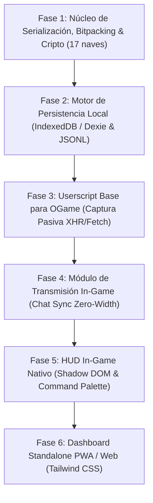

# 📋 PLAN DE TRABAJO: REESTRUCTURACIÓN ASÍNCRONA LOCAL-FIRST DE GALAXYTOOL

Este plan define las fases de ejecución técnica para construir la nueva arquitectura moderna, asíncrona, sin base de datos externa y con soporte para todas las flotas de OGame moderno.

---

## 🗺️ Estructura de Fases

---

### 🔹 Fase 1: Núcleo de Serialización, Bitpacking & Cripto (EN EJECUCIÓN)
* **Objetivo:** Diseñar la capa criptográfica y de ultra-compresión en JavaScript puro (compatible con Node.js y navegadores).
* **Entregables:**
  * [`src/core/constants.js`](file:///c:/Users/Alex/Documents/2026%20B/galaxytool_5_1/galaxytool/src/core/constants.js): Catálogo de las 17 naves modernas (IDs 202-219, incluyendo Segador, Explorador y Taladrador), clases de jugador y formas de vida.
  * [`src/core/encoder.js`](file:///c:/Users/Alex/Documents/2026%20B/galaxytool_5_1/galaxytool/src/core/encoder.js): Empaquetado binario (`Uint8Array`, `DataView`) con máscara de 64 bits y Varints.
  * [`src/core/crypto.js`](file:///c:/Users/Alex/Documents/2026%20B/galaxytool_5_1/galaxytool/src/core/crypto.js): Cifrado simétrico AES-256-GCM con Web Crypto API nativa.
  * [`src/core/zero-width.js`](file:///c:/Users/Alex/Documents/2026%20B/galaxytool_5_1/galaxytool/src/core/zero-width.js): Inyector y extractor de esteganografía con caracteres invisibles para chat.
  * Suite de pruebas unitarias automatizadas (`tests/test_modern_core.mjs`).

---

### 🔹 Fase 2: Motor de Persistencia Local (IndexedDB & JSONL)
* **Objetivo:** Reemplazar MySQL por almacenamiento estructurado client-side y archivos JSON particionados.
* **Entregables:**
  * [`src/storage/db.js`](file:///c:/Users/Alex/Documents/2026%20B/galaxytool_5_1/galaxytool/src/storage/db.js): Almacén IndexedDB con índices B-Tree en coordenadas y jugadores.
  * Exportador/Importador a `.json` y `.jsonl` para respaldo manual o por micro-servicio.

---

### 🔹 Fase 3: Userscript Base para OGame (Tampermonkey)
* **Objetivo:** Inyectar el motor en `*.ogame.gameforge.com` para captura pasiva y sin bots.
* **Entregables:**
  * `galaxytool-modern.user.js`: Script contenedor con hooks para `window.fetch` y `XMLHttpRequest` sobre `page=galaxyContent` y `page=messages`.

---

### 🔹 Fase 4: Módulo de Transmisión In-Game (Chat Sync)
* **Objetivo:** Intercambio de inteligencia militar automático mediante el chat de alianza de OGame.
* **Entregables:**
  * Módulo de escucha del WebSocket/polling del chat.
  * Difusión invisible y extracción automática de reportes de compañeros en tiempo real.

---

### 🔹 Fase 5: HUD In-Game Nativo (Head-Up Display)
* **Objetivo:** Asistencia visual táctica sobre la propia interfaz de OGame.
* **Nota Regla 6:** Todo aspecto visual, layout y paleta quedará sujeto a la revisión exclusiva del usuario.
* **Entregables:**
  * Command Palette (`Ctrl + K` / `Alt + G`).
  * Asistente de despacho de flota (cálculo de naves de carga para saqueo).
  * Marcadores en vista de galaxia.

---

### 🔹 Fase 6: Dashboard Standalone PWA / Web (Completada ✅)
* **Objetivo:** Panel táctico independiente para análisis estratégico y uso móvil sin servidores centralizados.
* **Nota Regla 6:** Todo aspecto visual, layout y paleta queda sujeto a la revisión exclusiva del usuario.
* **Entregables Implementados:**
  * Aplicación web responsiva con Tailwind CSS (`dashboard/index.html`).
  * Explorador de Galaxia y Sistemas Solares (1:1 a 9:499 con vista de 15 posiciones, lunas, escombros y antigüedad).
  * Radar de Inactivos y Buscador de Objetivos (`i`, `I`, filtros por botín mínimo y escombros).
  * Dossier de Reportes de Espionaje con modal detallado (17 naves modernas, recursos, defensas, formas de vida).
  * Calculadora Táctica de Granjeo y Transporte (naves SC, LC, PATH con factores 50%, 75% Descubridor, 100% Bandido).
  * Módulo de Gestión de Inteligencia: Respaldo y restauración en formato JSON Lines (`.jsonl`), generador de datos demo y borrado local.
  * PWA Manifiesto (`dashboard/manifest.json`) y Service Worker (`dashboard/sw.js`) para funcionamiento offline e instalación móvil.
  * Suite de pruebas automatizadas: `tests/test_dashboard.mjs` (7 pruebas unitarias aprobadas).

