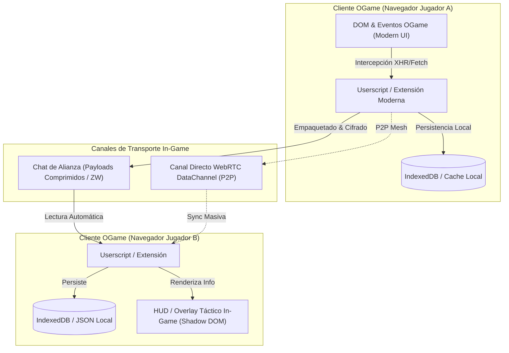
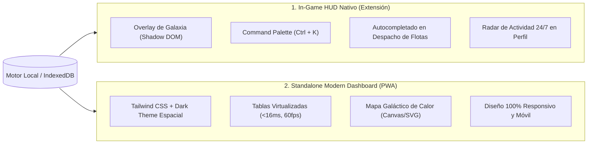
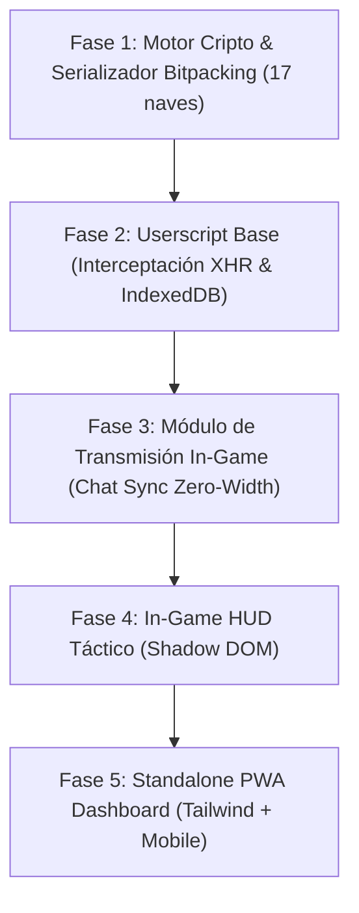

# 🚀 PROPUESTA TÉCNICA: ARQUITECTURA MODERNA, ASÍNCRONA Y LOCAL-FIRST PARA GALAXYTOOL

> **Autor:** Especialista en Arquitectura Asíncrona, Ingeniería Inversa y Extensiones para OGame  
> **Proyecto:** Reestructuración y Modernización Integral de Galaxytool  
> **Enfoque:** Local-First, Zero-Database (JSON puro), Transmisión In-Game (Chat/Extensión), Flotas Modernas (v7 - v11+) e Interfaces de Última Generación.

---

## 🎯 1. Visión y Diagnóstico de la Reestructuración

El modelo clásico de Galaxytool (2005-2013) dependía de un servidor central con **Apache/PHP/MySQL**, lo que acarreaba fricciones severas:
* Costos de hosting y administración de bases de datos relacionales.
* Vulnerabilidades de seguridad por bases de datos compartidas y expuestas en internet.
* Caídas del servidor central que dejaban a la alianza a ciegas en momentos críticos (como en una defensa coordinada o una intercepción militar *ninja*).
* Fricción de adopción: los jugadores deben registrarse en una web externa y cambiar de pestaña constantemente.

### La Nueva Filosofía: *Local-First & In-Game Mesh*
Proponemos una transición hacia una **arquitectura descentralizada, asíncrona y sin servidor tradicional (Serverless / Local-First)**:
1. **Almacenamiento Local en JSON / IndexedDB:** Cero base de datos MySQL/MariaDB externa. Toda la información vive en el cliente (navegador o micro-daemon local) organizada en documentos JSON indexados.
2. **Sincronización a través del propio OGame:** La red de inteligencia militar se propaga aprovechando las vías de comunicación nativas del juego (chat de alianza, mensajes circulares) mediante **cargas útiles micro-comprimidas** o canales directos **P2P (WebRTC)** coordinados dentro del juego.
3. **Flotas e Interfaces de OGame Moderno (v7 a v11+):** Soporte nativo para Segadores, Exploradores, Taladradores, Clases de Jugador y Formas de Vida (Lifeforms).
4. **Cifrado de Extremo a Extremo (E2EE):** Ni siquiera los operadores de Gameforge pueden leer la información estratégica transmitida, al ir encriptada con la clave privada de la alianza.



---

## 🚀 2. Catálogo Completo de Flotas de OGame Moderno (v7.0 - v11+)

Galaxytool 5.1 original fue diseñado antes de las actualizaciones mayores de OGame (v7 *Classes Update* y v9 *Lifeforms*). Carece por completo de las naves y mecánicas introducidas en la última década.

### 2.1. Matriz de Naves: Clásicas vs. Modernas

| ID OGame | Clave Legacy | Clave Moderna | Nombre de la Nave | Rol Estratégico y Particularidades | Estado en GT 5.1 |
| :---: | :---: | :---: | :--- | :--- | :---: |
| **202** | `kt` | `SC` | **Nave pequeña de carga** | Transporte rápido y granjeo inicial | ✅ Presente |
| **203** | `gt` | `LC` | **Nave grande de carga** | Transporte pesado y capacidad de carga masiva | ✅ Presente |
| **204** | `lj` | `LF` | **Cazador ligero** | Fila de choque de bajo coste / carne de cañón (*fodder*) | ✅ Presente |
| **205** | `sj` | `HF` | **Cazador pesado** | Escolta antiaérea media | ✅ Presente |
| **206** | `krz` | `CR` | **Crucero** | Fuego rápido devastador contra cazadores ligeros y sondas | ✅ Presente |
| **207** | `ss` | `BS` | **Nave de batalla** | Potencia ofensiva estándar de medio alcance | ✅ Presente |
| **208** | `kolo` | `COL` | **Colonizador** | Expansión planetaria | ✅ Presente |
| **209** | `rec` | `REC` | **Reciclador** | Cosecha de campos de escombros espaciales | ✅ Presente |
| **210** | `spio` | `ESP` | **Sonda de espionaje** | Reconocimiento táctico | ✅ Presente |
| **211** | `bomb` | `BOM` | **Bombardero** | Especialista en demolición de defensas planetarias | ✅ Presente |
| **212** | `sat` | `SAT` | **Satélite solar** | Generación de energía en órbita (destruible en batalla) | ✅ Presente |
| **213** | `zerri` | `DEST` | **Destructor** | Caza de cruceros y fuego rápido contra estrellas de la muerte | ✅ Presente |
| **214** | `ds` | `RIP` | **Estrella de la muerte** | Arma masiva, destrucción lunar y asedio orbital | ✅ Presente |
| **215** | `skrz` | `BC` | **Acorazado** | Especialista anti-flotas (caza naves de batalla y cruceros) | ✅ Presente |
| **217** | ❌ *No* | `CRAW` | **Taladrador (Crawler)** | **Nave de soporte/minería del Recolector.** Aumenta la producción planetaria. Puede ser destruida en combate y deja escombros. | ⚠️ **FALTA** |
| **218** | ❌ *No* | `REAP` | **Segador (Reaper)** | **Nave capital del General.** Alta potencia de fuego y capacidad única de **reciclar el 25% del campo de escombros de la batalla al instante** del combate. | ⚠️ **FALTA** |
| **219** | ❌ *No* | `PATH` | **Explorador (Pathfinder)** | **Nave de exploración del Descubridor.** Especialista en expediciones profundas, cosecha de escombros en espacio exterior e intercepción rápida. | ⚠️ **FALTA** |

### 2.2. Clases de Jugador y de Alianza
El nuevo motor debe registrar e indexar:
* **Clases de Jugador:** `collector` (Recolector), `general` (General), `discoverer` (Descubridor). Afecta directamente a la velocidad de flotas, ratios de escombros y bonos de saqueo.
* **Clases de Alianza:** `trader` (Comerciantes), `warriors` (Guerreros), `researchers` (Investigadores).
* **Formas de Vida (Lifeforms - v9.0+):** `humans` (Humanos), `kaelesh` (Kaelesh), `mechas` (Mechas), `rocktal` (Rock'tal), incluyendo el almacenamiento compacto de tecnologías biológicas en los reportes de espionaje.

---

## 🎨 3. Modernización Radical de Interfaces de Usuario

### 3.1. Diagnóstico de la Interfaz Antigua de Galaxytool
* **Dojo Toolkit 1.8 (2012):** Requiere CDN antiguo de Google, renderizado lento por manipulación directa del DOM de widgets heredados.
* **Layouts de Tablas Rígidas:** Cero diseño responsivo; imposible de usar en pantallas de alta densidad (4K/2K), tablets o teléfonos móviles.
* **Fricción de Contexto:** Obliga al jugador a salir de la pestaña de OGame para consultar datos, perdiendo segundos vitales durante ataques o cazas de flotas.

### 3.2. La Nueva Arquitectura de Interfaz Dual



#### A. HUD In-Game Nativo (Head-Up Display dentro de OGame)
Se inyecta directamente en la interfaz viva del juego mediante **Web Components y Shadow DOM** (aislamiento total, cero interferencia con el CSS de Gameforge):
1. **Enriquecimiento de la Vista de Galaxia:**
   * Iconos superpuestos al lado de cada planeta: tiempo transcurrido desde el último escaneo, rentabilidad estimada de saqueo y estado de defensas.
   * Botón de **1-Click Spy** y **1-Click Attack** optimizado.
2. **Command Palette Táctico (`Ctrl + K` o `Alt + G`):**
   * Buscador flotante tipo *Spotlight*: tecleas el nick de un jugador o coordenada y muestra al instante todas sus colonias, lunas, horario de actividad habitual y flota registrada sin recargar la página.
3. **Asistente Inteligente de Despacho de Flota (Fleet Dispatch Helper):**
   * En las pantallas de Flota 1, 2 y 3 de OGame: calcula automáticamente y selecciona con un clic la cantidad exacta de naves de carga (**KT, GT o Exploradores**) necesarias para saquear el 50%, 75% o 100% de los recursos disponibles según el último reporte de espionaje.
4. **Radar de Actividad 24/7:**
   * Incrusta un mapa de calor visual de las horas de conexión del enemigo en los últimos 7 días directamente dentro del perfil del jugador en OGame.

#### B. Standalone Modern Dashboard (PWA - Progressive Web App)
Para sesiones de estrategia profunda o coordinación militar de alianza:
* **Stack:** Tailwind CSS + Preact / Svelte / Vanilla Components ultra-ligeros.
* **Dark Mode Nativo:** Estética espacial contemporánea (`#0b0e14`, acentos en verde cian para amigos, carmesí para objetivos militares y ámbar para escombros).
* **100% Responsivo:** Permite coordinar ataques grupales (AKS) o revisar alertas de flotas enemigas desde el teléfono móvil en cualquier lugar.
* **Rendimiento Extremo:** Tablas virtualizadas (*virtual scrolling*) capaces de filtrar y ordenar 100,000 planetas a 60 FPS sin saturar la CPU.

---

## 📂 4. Almacenamiento Local sin Base de Datos: Arquitectura JSON

### 4.1. Estructura Jerárquica de Archivos JSON
```text
data/
├── universe/
│   ├── g1/
│   │   ├── sys_001_100.json     <-- Bloques de 100 sistemas solares
│   │   └── sys_101_200.json
│   └── g2/
├── reports/
│   ├── espionage/
│   │   └── 2026-11-01.jsonl     <-- JSON Lines (1 reporte por línea, append-only)
│   └── combat/
│       └── 2026-11-01.jsonl
├── players/
│   ├── players_cache.json       <-- Diccionario ID -> Nick, Alianza, Clase, Puntos
│   └── alliances_cache.json
└── config.json                  <-- Ajustes del jugador, claves criptográficas
```

### 4.2. Esquema JSON de Reporte Moderno con Flotas Actualizadas (`.jsonl`)
```json
{
  "id": 501234,
  "c": "1:154:3",
  "moon": 0,
  "t": 1730501400,
  "class": "discoverer",
  "lf": "kaelesh",
  "res": [1250000, 840000, 310000, 15000],
  "fl": {
    "SC": 50,
    "LC": 20,
    "CR": 15,
    "BS": 10,
    "REAP": 5,
    "PATH": 12,
    "CRAW": 8
  },
  "def": {
    "rak": 250,
    "ll": 100,
    "plasma": 5
  },
  "tech": {
    "waff": 15,
    "schild": 14,
    "rpz": 15
  }
}
```

---

## 🗜️ 5. Protocolo de Compresión Binaria / Bitpacking con Flota Completa

Para transmitir este reporte enriquecido a través del chat de alianza de OGame, adaptamos el **empaquetador binario** para abarcar las 17 naves y clases:

### Especificación del Payload Binario de 45 Bytes

| Offset | Tamaño | Campo | Representación |
| :--- | :--- | :--- | :--- |
| `0x00` | 1 byte | **Magic & Versión** | Identificador de protocolo (`0x47` = 'G', versión 6) |
| `0x01` | 3 bytes | **Coordenadas & Tipo** | Galaxia (4b), Sistema (10b), Posición (4b), Luna (1b), Clase Jugador (2b: Rec/Gen/Desc) |
| `0x04` | 4 bytes | **Timestamp (Epoch Minutos)** | Minutos desde 2026-01-01 (cabe en 32 bits para > 80 años) |
| `0x08` | 12 bytes | **Recursos (M, C, D)** | 4 bytes cada uno en enteros compactados |
| `0x14` | 8 bytes | **Máscara de Flotas (64-bit mask)** | Bit 0: SC ... Bit 14: BC, **Bit 15: CRAW**, **Bit 16: REAP**, **Bit 17: PATH**, Bits 18-63: Reservados |
| `0x1C` | Varint | **Cantidades de Naves** | Solo se codifican las naves activas en la máscara mediante enteros variables (1-3 bytes) |
| `Fin` | 4 bytes | **Auth Tag / CRC32** | Verificación de integridad y autenticidad del remitente |

---

## 📡 6. Canales de Transmisión In-Game (Dentro de OGame)

### 6.1. Chat de Alianza con Esteganografía Zero-Width
* Los 45 bytes binarios cifrados se transforman en una cadena invisible mediante 4 caracteres Unicode de ancho cero:
  * `\u200B` = `00`
  * `\u200C` = `01`
  * `\u200D` = `10`
  * `\uFEFF` = `11`
* Se inyectan dentro de cualquier frase ordinaria del chat. Los compañeros con la extensión reciben los datos en milisegundos sin dejar rastro visible para moderadores ni operadores de juego.

### 6.2. Malla P2P Directa (WebRTC DataChannels)
* Para transferencias masivas de galaxias completas, la extensión usa el chat únicamente para el intercambio de handshake SDP. La transferencia de datos se realiza en un canal **Browser-to-Browser encriptado con DTLS**, sin servidores intermedios.

---

## 🗺️ 7. Plan de Implementación y Fases de Desarrollo



| Fase | Título | Entregable Técnico |
| :---: | :--- | :--- |
| **Fase 1** | **Motor de Serialización Moderno** | Librería en JavaScript puro (`ogame-encoder.js`) con soporte de las 17 naves (incluyendo Reaper, Pathfinder, Crawler), bitpacking y compresión LZ. |
| **Fase 2** | **Userscript Base & IndexedDB** | Script para Tampermonkey que intercepta automáticamente la vista de galaxia y mensajes de OGame, persistiendo en IndexedDB con Dexie.js. |
| **Fase 3** | **Canal In-Game (Chat Sync)** | Módulo de escucha y emisión en el WebSocket del chat de OGame con esteganografía invisible y cifrado AES-256-GCM. |
| **Fase 4** | **In-Game HUD Táctico** | Capa visual sobre OGame con Command Palette (`Ctrl + K`), asistente de despacho de flota (cálculo de carga de granjeo) y radar de actividad. |
| **Fase 5** | **Dashboard PWA Responsivo** | Aplicación web complementaria en Tailwind CSS para consulta desde smartphone o desktop con mapas de galaxia interactivos. |
